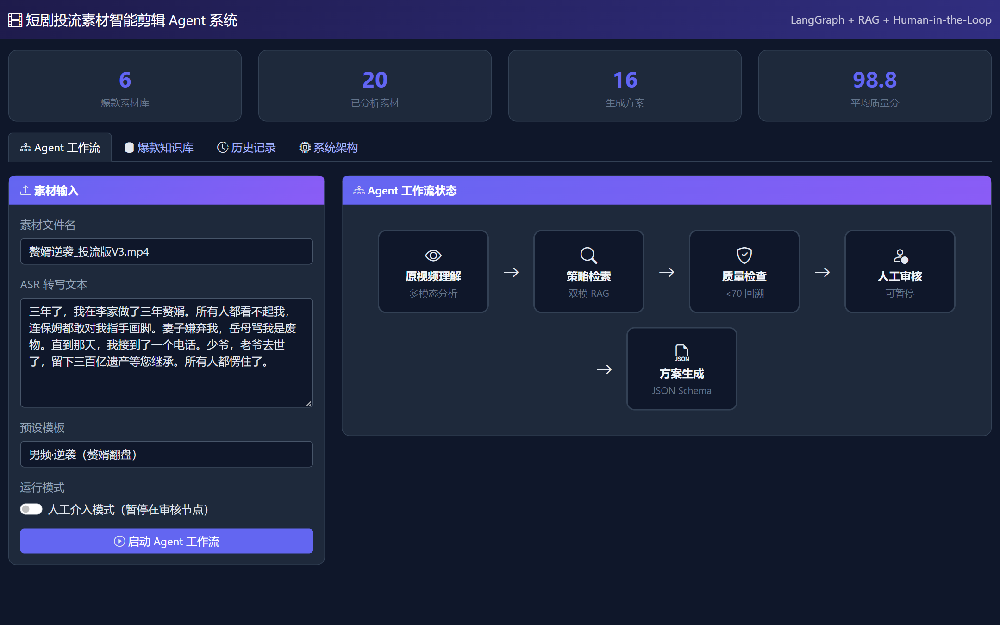
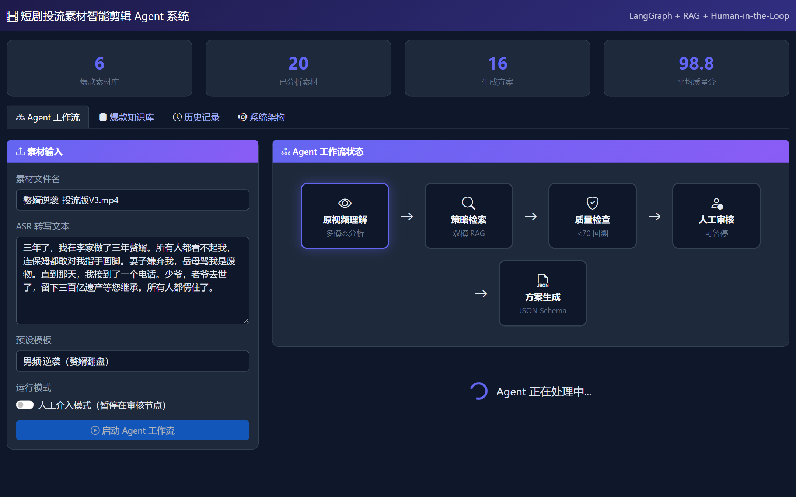
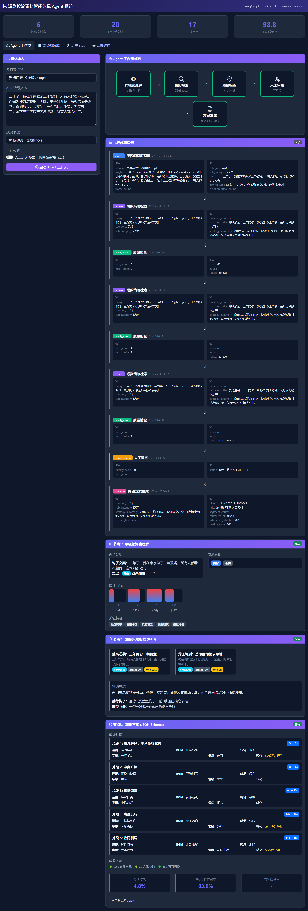
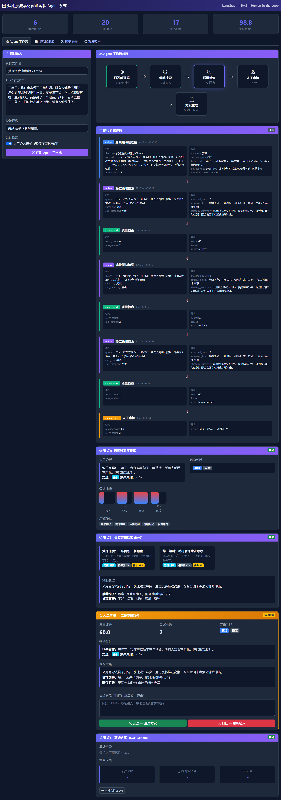
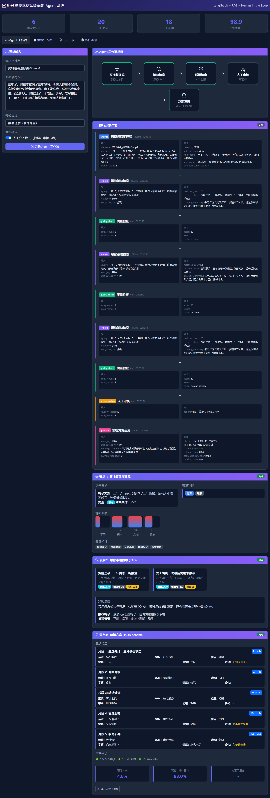
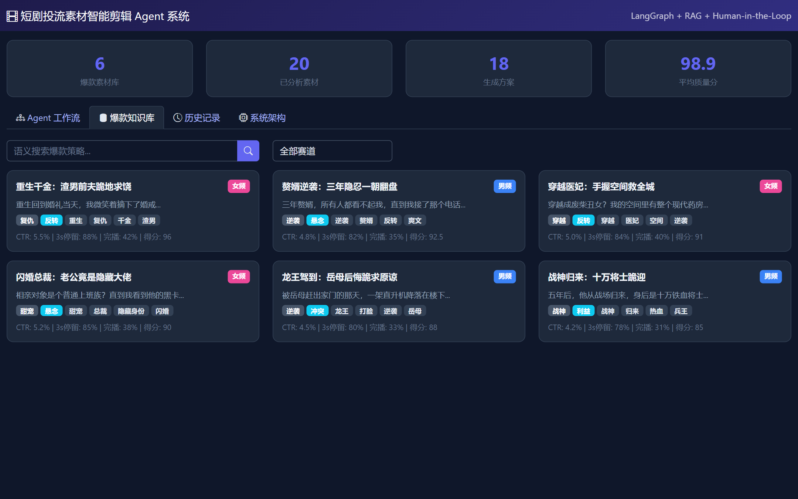
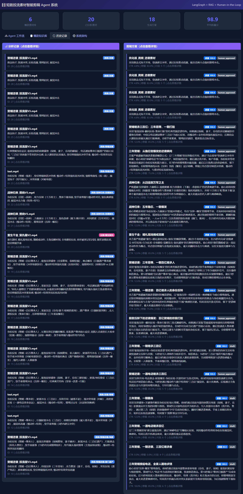
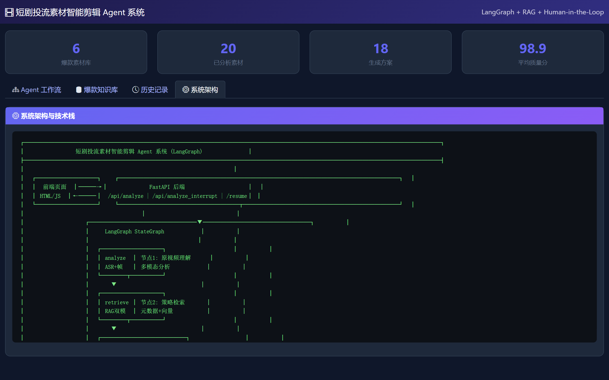

# 短剧投流素材智能剪辑 Agent 系统

基于 **LangGraph** 的短剧投流素材智能剪辑方案生成系统：输入一条短剧素材（ASR 文本 + 抽帧画面），Agent 工作流自动完成「原视频深度理解 → 爆款策略检索（双模 RAG） → 质量检查与回溯 → 人工审核 → 剪辑方案生成」，输出结构化（JSON Schema）的高转化剪辑脚本，并通过投流效果回传持续校准知识库权重（数据飞轮）。

## ✨ 核心特性

- **Agent 工作流编排** — LangGraph StateGraph，6 节点 + 条件边路由，支持质量不达标**回溯重试**（quality_check < 70 分 → 重新检索）
- **Human-in-the-Loop** — `analyze_interrupt` / `resume` 接口实现人工审核暂停/恢复，可一键打回重新检索
- **双模 RAG 检索** — 元数据预过滤（赛道硬规则）+ FAISS 余弦相似度向量检索（软匹配）两层召回
- **多模态视频理解** — OpenCV 抽帧 + Whisper ASR + Qwen-VL 帧级画面分析（场景/视觉钩子/情绪/构图）
- **JSON Schema 结构化输出** — Pydantic Schema + JsonOutputParser 强约束 LLM 输出，剪辑片段精确到秒级时间轴、运镜、BGM 卡点
- **数据飞轮** — 投流效果回传加权更新爆款素材 score，高分策略优先被召回
- **全链路可观测** — 结构化日志 + Prometheus 指标 + Grafana 看板（请求量/延迟/反馈数）
- **优雅降级** — 所有外部依赖（LLM/Embedding/MLLM/Whisper/OpenCV）均有 mock 兜底，零 Key 也能完整跑通

## 📸 运行效果

### Agent 工作流 — 素材输入

预设 4 种题材模板（男频·逆袭 / 女频·复仇 / 男频·战神 / 女频·甜宠）一键填充，工作流 5 节点状态实时可视化：



### 工作流运行中

节点状态渐变推进，质量检查 < 70 分自动回溯重试：



### 运行结果 — 三节点完整输出

**节点1** 原视频深度理解（钩子分析 / 赛道判断 / 情绪曲线 / 关键特征）→ **节点2** 爆款策略检索（相似度排序的素材卡片 + 策略总结）→ **节点3** 剪辑方案（秒级时间轴片段 / 运镜 / BGM 卡点 / 预估 CTR）：



### 人工审核暂停（Human-in-the-Loop）

开启人工介入模式后，工作流在审核节点暂停，展示质量评分与检索策略，支持**通过生成**或**打回重新检索**：



审核通过后继续执行至方案生成：



### 爆款知识库

6 条爆款素材知识卡片（钩子文案 / CTR / 3秒停留率 / 完播率 / 综合得分），支持语义搜索与赛道筛选：



### 历史记录

历史分析记录与剪辑方案，可展开查看完整 JSON：



### 系统架构

技术架构总览页：



## 🚀 快速开始

```bash
cd drama_agent_system

# 1. 安装核心依赖
pip install langchain langchain-openai fastapi uvicorn faiss-cpu httpx sqlalchemy prometheus-client

# 2.（可选）配置 API Key — 不配置也能跑，所有外部依赖有 mock 兜底
cp .env.example .env
# 编辑 .env 填入 LLM_API_KEY / DASHSCOPE_API_KEY

# 3. 启动服务
python -m uvicorn main:app --host 0.0.0.0 --port 8080

# 4. 浏览器访问
# http://localhost:8080
```

可选监控栈（Prometheus + Grafana）：

```bash
docker-compose up -d
# Prometheus: http://localhost:9090
# Grafana:    http://localhost:3000 (admin/admin)
```

重新生成 README 截图（需先启动服务）：

```bash
pip install playwright
python scripts/take_screenshots.py   # 使用系统 Edge 内核，截图输出到 docs/images/
```

## 📁 项目结构

```
drama_agent_system/
├── main.py                  # FastAPI 后端（API 路由 + 指标采集）
├── agent_workflow.py        # LangGraph 工作流（6节点 + 回溯 + 人工审核）
├── vector_store.py          # 双模 RAG 检索引擎（元数据预过滤 + FAISS）
├── video_processor.py       # 多模态视频处理（抽帧 + ASR + MLLM）
├── models.py                # SQLAlchemy 表结构 + Pydantic 输出 Schema
├── mock_data.py             # 种子数据（6条爆款素材知识库）
├── metrics.py               # Prometheus 指标定义
├── logger.py                # 结构化日志
├── config.py                # 配置（从 .env 读取 API Key）
├── static/index.html        # 前端（Bootstrap 5，4 Tab 页）
├── scripts/
│   └── take_screenshots.py  # README 截图脚本（Playwright + Edge）
├── docs/                    # 延伸技术文档 + 运行截图
│   └── images/              # README 截图
├── data/                    # 运行时数据（SQLite + FAISS 索引，gitignore）
├── docker-compose.yml       # Prometheus + Grafana 监控栈
├── prometheus.yml           # Prometheus 抓取配置
├── grafana_dashboard.json   # Grafana 看板模板
├── .env.example             # 环境变量模板
└── README.md
```

---

## 一、系统概述

### 1.1 业务背景
短剧投流素材迭代极快，人工拆解效率低，爆款基因难以稳定复制。本系统基于 Agent Workflow 构建智能剪辑方案生成系统，替代传统单点长 Prompt 模式，自动生成高转化潜力的结构化剪辑脚本。

### 1.2 技术栈
| 技术 | 用途 | 对应简历关键词 |
|------|------|--------------|
| LangGraph | Agent 工作流编排（StateGraph） | LangGraph, Agent Workflow |
| LangChain | LLM 调用、Prompt 模板、JSON 解析 | LangChain |
| mimo (mllm) | LLM 推理（分析/生成） | mllm |
| Qwen-VL | 多模态帧画面理解 | mllm |
| Whisper | ASR 语音转文字 | ASR |
| FAISS | 向量检索算法库 | Vector DB |
| 阿里云 Embedding | 文本向量化 | Vector DB |
| SQLite | 结构化数据存储 | PostgreSQL (demo 用 SQLite) |
| FastAPI | 后端 API 服务 | — |
| Prometheus + Grafana | 指标监控与可视化 | — |
| JSON Mode / JsonOutputParser | 结构化输出控制 | JSON Mode / Function Calling |

---

## 二、系统架构

```
┌──────────────────────────────────────────────────────────────┐
│                       前端 (static/index.html)               │
│  Bootstrap 5 + 原生 JS，4 个 Tab 页                          │
└───────────────────────────┬──────────────────────────────────┘
                            │ HTTP API
┌───────────────────────────▼──────────────────────────────────┐
│                    FastAPI 后端 (main.py)                     │
│  路由: /api/references, /api/analyze, /api/plans, /api/search │
└──────┬──────────────────┬───────────────────┬────────────────┘
       │                  │                   │
       ▼                  ▼                   ▼
┌─────────────┐  ┌─────────────────┐  ┌────────────────┐
│ agent_       │  │ vector_store.py │  │ video_         │
│ workflow.py  │  │ 双模 RAG 检索   │  │ processor.py   │
│              │  │                 │  │ 视频处理       │
│ 节点1: 分析  │  │ 元数据预过滤    │  │ 帧抽取+MLLM   │
│ 节点2: 检索  │  │ + FAISS 向量检索│  │ ASR 转写       │
│ 节点3: 生成  │  │                 │  │                │
└──────┬──────┘  └────────┬────────┘  └───────┬────────┘
       │                  │                   │
       ▼                  ▼                   ▼
┌──────────────────────────────────────────────────────────────┐
│                        数据层                                 │
│  SQLite (data/app.db)    FAISS 文件 (data/faiss_index.*)     │
│  - hot_references        - faiss_index.index (向量索引)       │
│  - material_analysis     - faiss_index.meta (元数据 JSON)     │
│  - edit_plans            - data/frames/ (抽取的帧图片)        │
└──────────────────────────────────────────────────────────────┘
```

---

## 三、核心功能详解

### 3.1 Agent 工作流（agent_workflow.py）

采用 **LangGraph StateGraph** 构建工作流，包含 6 个节点，支持**回溯重试**和**人工介入**。

#### 工作流拓扑

```
analyze → retrieve → quality_check ──→ human_review → generate → END
                          │                    │
                          │ <70分               │ 打回
                          ▼                    ▼
                    retry_increment ──→ retrieve（回溯）
```

#### 状态定义（WorkflowState）

```python
class WorkflowState(TypedDict):
    asr_text: str              # 输入
    filename: str
    frame_descriptions: list
    analysis: dict             # 节点1输出
    strategy: dict             # 节点2输出
    plan: dict                 # 节点3输出
    quality_score: float       # 质量评分
    retry_count: int           # 回溯重试次数
    max_retries: int           # 最大重试次数（默认2）
    human_feedback: str        # 人工反馈意见
    human_approved: bool       # 人工是否通过
    need_human_review: bool    # 是否需要人工审核
    current_node: str          # 当前节点
    status: str                # pending/running/paused/completed
```

#### 节点说明

| 节点 | 函数 | 说明 |
|------|------|------|
| analyze | `node_analyze()` | 原视频深度理解（多模态分析） |
| retrieve | `node_retrieve()` | 爆款策略检索（双模 RAG） |
| quality_check | `node_quality_check()` | 质量评分，<70分触发回溯 |
| retry_increment | `node_retry_increment()` | 递增重试计数 |
| human_review | `node_human_review()` | 人工审核暂停点 |
| generate | `node_generate()` | 剪辑方案生成（JSON Schema） |

#### 回溯机制

质量检查节点对分析和检索结果进行评分（满分100），评分规则：
- 钩子效果预估 < 0.5 → -15分
- 赛道未判断 → -20分
- 关键特征不足 3 个 → -10分
- 无匹配策略 → -20分
- 策略总结为空 → -10分

得分 < 70 且重试次数 < 2 → 回溯到 retrieve 节点重新检索
得分 < 70 且已达最大重试 → 强制进入人工审核

#### 人工介入

系统提供两种运行模式：
1. **自动模式** (`run_workflow`): `human_approved=True` 默认通过，跳过人工审核
2. **人工介入模式** (`run_workflow_with_interrupt`): 在 human_review 节点暂停，返回中间状态

```python
# 自动模式
result = run_workflow(asr_text, filename)

# 人工介入模式
paused = run_workflow_with_interrupt(asr_text, filename)
# 用户审核后恢复
result = resume_workflow(paused["state"], approved=True, feedback="钩子需要更强")
```

LangGraph 的条件边实现：
```python
# quality_check 后的路由
graph.add_conditional_edges("quality_check", route_after_quality, {
    "retrieve": "retry_increment",    # 回溯
    "human_review": "human_review",   # 进入审核
})

# human_review 后的路由
graph.add_conditional_edges("human_review", route_after_human, {
    "generate": "generate",   # 通过→生成
    "retrieve": "retrieve",   # 打回→重新检索
})
```

#### 节点1：原视频深度理解 — `node_analyze()`

**输入**: ASR 文本 + 帧级画面描述
**输出**: 结构化分析结果（钩子分析、情绪曲线、赛道判断、关键特征）

```python
# 核心 Prompt
ANALYSIS_PROMPT = ChatPromptTemplate.from_messages([
    ("system", "你是一位资深短剧投流素材分析师..."),
    ("user", "素材信息：\n- 文件名：{filename}\n- ASR 转写文本：{asr_text}\n- 帧级画面描述：{frame_descriptions}"),
])

# 执行链
chain = ANALYSIS_PROMPT | llm | JsonOutputParser()
result = chain.invoke({...})
```

**提取维度**:
| 维度 | 字段 | 说明 |
|------|------|------|
| 钩子分析 | hook_analysis | 文案、类型(悬念/冲突/反转/利益)、效果预估 |
| 情绪曲线 | emotion_curve | 多时间点的情绪强度(0-1)和标签 |
| 赛道判断 | category, sub_category | 男频/女频 + 逆袭/甜宠/复仇/战神/穿越 |
| 关键特征 | key_features | 至少 5 个特征标签 |
| 帧级描述 | frame_descriptions | 时间戳、场景、动作、视觉钩子 |
| 音画卡点 | beat_points | 时间、类型、强度、描述 |

**兜底机制**: LLM 调用失败时，调用 `_mock_analysis()` 返回预设模拟数据。

**数据持久化**: 分析结果存入 SQLite `material_analysis` 表。

---

#### 节点2：爆款策略检索 — `node_retrieve()`

**输入**: 节点1 的分析结果
**输出**: 匹配的爆款策略 + 策略总结

**检索流程**:

```
Step 1: 元数据预过滤（硬规则）
  → 按 category + sub_category 过滤候选集
  → 例如: category="男频", sub_category="逆袭" → 候选集缩小到 2 条

Step 2: 语义向量检索（软匹配）
  → 拼接 hook_text + key_features 作为查询文本
  → 调用阿里云 Embedding API → 1024 维向量
  → FAISS IndexFlatIP 余弦相似度搜索
  → 返回 top_k 最相似结果

Step 3: 综合排序
  → 按 score 降序（score 受数据飞轮权重影响）
```

**双模 RAG 代码**:
```python
def search(self, query, category=None, sub_category=None, top_k=3):
    # Step 1: 元数据预过滤
    candidates = list(range(len(self.metadata)))
    if category:
        candidates = [i for i in candidates if self.metadata[i]["category"] == category]
    if sub_category:
        candidates = [i for i in candidates if self.metadata[i]["sub_category"] == sub_category]

    # Step 2: 向量检索
    query_vec = np.array([self._get_embedding(query)], dtype="float32")
    faiss.normalize_L2(query_vec)
    scores, indices = self.index.search(query_vec, top_k, params=params)

    # Step 3: 按 score 排序
    results.sort(key=lambda x: x.get("score", 0), reverse=True)
    return results[:top_k]
```

**LLM 策略总结**: 检索完成后，用 LLM 对匹配的爆款素材进行策略总结，提取可复用的钩子方案、情绪节奏、关键学习点。

**兜底机制**: LLM 调用失败时，调用 `_mock_retrieval()` 返回预设策略。

---

#### 节点3：剪辑方案生成 — `node_generate()`

**输入**: 节点1 分析结果 + 节点2 策略结果
**输出**: 完整结构化剪辑方案（严格 JSON Schema）

**JSON Schema 强制输出**:
```python
class EditPlanSchema(BaseModel):
    plan_id: str
    title: str
    target_duration: str
    category: str
    sub_category: str
    hook_analysis: HookAnalysis          # 钩子分析
    emotion_curve: list[EmotionPoint]    # 情绪曲线
    segments: list[EditSegment]          # 剪辑片段列表
    beat_points: list[BeatPoint]         # 音画卡点
    strategy_summary: str                # 策略摘要
    estimated_ctr: float                 # 预估点击率
    estimated_retention: float           # 预估停留率
```

**剪辑片段 Schema (EditSegment)**:
```python
class EditSegment(BaseModel):
    segment_id: int          # 片段序号
    start_time: str          # 开始时间
    end_time: str            # 结束时间
    duration: str            # 时长
    scene_description: str   # 画面描述
    camera_movement: str     # 运镜方式
    bgm_cue: str             # BGM 卡点说明
    text_overlay: str        # 字幕/文案
    transition: str          # 转场效果
    conversion_hook: str     # 转化引导话术
    emotion_target: str      # 目标情绪
```

**输出控制**: 使用 LangChain 的 `JsonOutputParser` 强制 LLM 返回合法 JSON，Prompt 中明确要求 JSON Schema 格式。

**兜底机制**: LLM 调用失败时，调用 `_mock_plan()` 返回预设方案（包含 5 个标准片段）。

**数据持久化**: 方案存入 SQLite `edit_plans` 表。

---

#### 工作流编排 — `run_workflow()`

```python
def run_workflow(asr_text, filename, frame_descriptions=None, video_path=None):
    # 前置: 视频多模态处理（如果有视频文件）
    if video_path:
        video_result = process_video(video_path, asr_text)
        asr_text = video_result["asr_text"]
        frame_descriptions = video_result["frame_descriptions"]

    # 节点1 → 节点2 → 节点3
    analysis = node_analyze(asr_text, filename, frame_descriptions)
    strategy = node_retrieve(analysis)
    plan = node_generate(analysis, strategy)

    return {"analysis": analysis, "strategy": strategy, "plan": plan}
```

---

### 3.2 多模态视频处理（video_processor.py）

#### 3.2.1 帧抽取 — `extract_frames()`

| 功能 | 实现 | 依赖 |
|------|------|------|
| 视频读取 | OpenCV `cv2.VideoCapture` | opencv-python |
| 抽帧策略 | 每秒 1 帧，最多 30 帧 | — |
| 输出格式 | JPG 文件 + Base64 编码 | — |
| 兜底 | opencv 未安装时返回 6 个模拟帧 | — |

```python
def extract_frames(video_path, interval_sec=1.0, max_frames=30):
    cap = cv2.VideoCapture(video_path)
    fps = cap.get(cv2.CAP_PROP_FPS)
    frame_interval = int(fps * interval_sec)

    while cap.isOpened() and count < max_frames:
        cap.set(cv2.CAP_PROP_POS_FRAMES, frame_idx)
        ret, frame = cap.read()
        cv2.imwrite(frame_path, frame)           # 保存 JPG
        _, buffer = cv2.imencode('.jpg', frame)
        frame_b64 = base64.b64encode(buffer)     # Base64 编码
        frame_idx += frame_interval
```

#### 3.2.2 ASR 语音转写 — `transcribe_audio()`

| 功能 | 实现 | 依赖 |
|------|------|------|
| 语音识别 | OpenAI Whisper `base` 模型 | openai-whisper |
| 语言 | 中文 | — |
| 兜底 | whisper 未安装时返回模拟文本 | — |

#### 3.2.3 MLLM 多模态理解 — `analyze_frame_with_mllm()`

| 功能 | 实现 | 依赖 |
|------|------|------|
| 模型 | 阿里云百炼 Qwen-VL-Plus | DashScope API |
| 输入 | 帧图片 Base64 + 分析 Prompt | — |
| 输出 | 场景/动作/视觉钩子/情绪/构图/色调 | — |
| 兜底 | API 调用失败时返回模拟帧描述 | — |

```python
def analyze_frame_with_mllm(frame_base64, timestamp):
    payload = {
        "model": "qwen-vl-plus",
        "input": {
            "messages": [{
                "role": "user",
                "content": [
                    {"image": f"data:image/jpeg;base64,{frame_base64}"},
                    {"text": "请从以下维度分析：scene, action, visual_hook, emotion, composition, color_tone"}
                ]
            }]
        }
    }
    resp = httpx.post("https://dashscope.aliyuncs.com/.../generation", json=payload)
```

**帧分析输出维度**:
| 维度 | 说明 |
|------|------|
| scene | 场景描述 |
| action | 人物动作 |
| visual_hook | 视觉钩子（吸引注意力的元素） |
| emotion | 情绪氛围 |
| composition | 构图方式 |
| color_tone | 色调 |

---

### 3.3 双模 RAG 检索引擎（vector_store.py）

#### 3.3.1 向量化

| 项目 | 说明 |
|------|------|
| 模型 | 阿里云百炼 text-embedding-v3 |
| 维度 | 1024 |
| 向量化文本 | `title + hook_text + asr_text + tags` 拼接 |
| 兜底 | API 失败时生成随机向量 |

#### 3.3.2 索引构建

```python
# FAISS 索引类型: IndexFlatIP（内积）
# 配合 L2 归一化 = 余弦相似度
vectors_np = np.array(vectors, dtype="float32")
faiss.normalize_L2(vectors_np)
self.index = faiss.IndexFlatIP(1024)
self.index.add(vectors_np)
```

| 项目 | 说明 |
|------|------|
| 索引类型 | FAISS IndexFlatIP（暴力搜索，精确但慢） |
| 相似度 | 余弦相似度（L2 归一化 + 内积） |
| 持久化 | `faiss.write_index()` 写入文件 |
| 元数据 | 与向量对齐的 JSON 数组，单独存储 |

#### 3.3.3 FAISS vs 向量数据库

| 对比项 | FAISS | 向量数据库 (Milvus/Pinecone/Qdrant) |
|--------|-------|-----------------------------------|
| 本质 | 向量检索算法库 | 专用数据库 |
| 部署 | 嵌入式，import 即用 | 独立服务，需要部署 |
| 数据管理 | 手动管理文件 | CRUD、索引、分片、副本 |
| 查询能力 | 仅向量检索 | 向量+标量混合查询、过滤 |
| 扩展性 | 单机，百万级 | 分布式，十亿级 |
| 适用场景 | Demo/小规模/嵌入式 | 生产环境大规模部署 |

本系统用 FAISS 是因为 demo 场景数据量小（6条），不需要独立部署。生产环境应替换为 Milvus/Qdrant 等。

#### 3.3.4 双模检索流程

```
查询输入
    │
    ▼
┌──────────────────────────────┐
│ 第一层：元数据预过滤（硬规则） │
│ - category (男频/女频)        │
│ - sub_category (逆袭/甜宠...) │
│ → 候选集缩小                 │
└──────────────┬───────────────┘
               ▼
┌──────────────────────────────┐
│ 第二层：语义向量检索（软匹配） │
│ - 查询文本 → Embedding        │
│ - FAISS 余弦相似度            │
│ → top_k 结果                 │
└──────────────┬───────────────┘
               ▼
┌──────────────────────────────┐
│ 排序：按 score 降序           │
│ score 受数据飞轮权重影响       │
└──────────────────────────────┘
```

---

### 3.4 数据库设计（models.py）

#### 表结构

**hot_references — 爆款素材知识库**
| 字段 | 类型 | 说明 |
|------|------|------|
| id | Integer PK | 主键 |
| title | String | 素材标题 |
| category | String | 主赛道：男频/女频 |
| sub_category | String | 二级题材：逆袭/甜宠/复仇/战神/穿越 |
| hook_text | Text | 黄金3秒钩子文案 |
| hook_type | String | 钩子类型：悬念/冲突/反转/利益 |
| emotion_curve | JSON | 情绪曲线数据点列表 |
| beat_points | JSON | 音画卡点时间列表 |
| ctr | Float | 点击率 |
| retention_3s | Float | 3秒停留率 |
| completion_rate | Float | 完播率 |
| score | Float | 综合得分（数据飞轮权重） |
| tags | JSON | 标签列表 |
| asr_text | Text | ASR 转写文本 |
| frame_descriptions | JSON | 帧级画面描述列表 |

**material_analysis — 素材分析结果**
| 字段 | 类型 | 说明 |
|------|------|------|
| id | Integer PK | 主键 |
| filename | String | 文件名 |
| asr_text | Text | ASR 文本 |
| frame_descriptions | JSON | 帧描述 |
| hook_analysis | JSON | 钩子分析结果 |
| emotion_curve | JSON | 情绪曲线 |
| category / sub_category | String | 赛道判断 |
| key_features | JSON | 关键特征列表 |

**edit_plans — 剪辑方案**
| 字段 | 类型 | 说明 |
|------|------|------|
| id | Integer PK | 主键 |
| material_id | Integer FK | 关联分析记录 |
| plan_json | JSON | 完整剪辑方案 |
| strategy_refs | JSON | 引用的爆款策略 ID 列表 |
| quality_score | Float | 方案质量评分 |
| status | String | 状态：draft/reviewed/approved |

#### Pydantic Schema（结构化输出控制）

系统定义了严格的 JSON Schema，强制 LLM 输出合法结构：

```
EditPlanSchema (顶层)
├── HookAnalysis (钩子分析)
├── list[EmotionPoint] (情绪曲线)
├── list[EditSegment] (剪辑片段)
│   ├── segment_id, start_time, end_time, duration
│   ├── scene_description, camera_movement
│   ├── bgm_cue, text_overlay, transition
│   └── conversion_hook, emotion_target
├── list[BeatPoint] (音画卡点)
└── strategy_summary, estimated_ctr, estimated_retention
```

---

### 3.5 数据飞轮（main.py `/api/feedback`）

```
投流效果数据回传
    │
    ▼
POST /api/feedback
{ plan_id: 1, score: 85.0 }
    │
    ▼
找到 plan 引用的 strategy_refs
    │
    ▼
更新 hot_references.score
score = score * 0.8 + new_score * 0.2  (加权移动平均)
    │
    ▼
下次检索时，高分策略优先被召回
```

---

### 3.6 前端（static/index.html）

#### 页面结构

| Tab | 功能 | 说明 |
|-----|------|------|
| Agent 工作流 | 素材输入 + 工作流执行 + 结果展示 | 核心功能页 |
| 爆款知识库 | 浏览/搜索爆款素材 | 支持语义搜索和赛道筛选 |
| 历史记录 | 查看历史分析和方案 | 点击查看详情 JSON |
| 系统架构 | 技术架构图 | ASCII 架构图展示 |

#### Agent 工作流页

- **输入区**: 文件名、ASR 文本、预设模板（4种题材一键填充）
- **工作流可视化**: 5 个节点状态（理解→检索→质量检查→人工审核→生成）
- **结果展示**:
  - 节点1: 钩子分析、赛道判断、情绪曲线可视化、关键特征标签
  - 节点2: 检索到的爆款素材卡片、策略总结
  - 节点3: 剪辑片段时间线、音画卡点、预估指标、JSON 原文

#### 技术实现

- 前端框架: Bootstrap 5 + 原生 JavaScript
- API 调用: Fetch API
- 模板预设: 4 种题材（逆袭/复仇/战神/甜宠）一键填充
- 工作流动画: 节点状态渐变（模拟异步进度）

---

## 四、API 接口

| 方法 | 路径 | 说明 |
|------|------|------|
| GET | `/api/references?category=男频` | 获取爆款素材列表（可按赛道筛选） |
| POST | `/api/analyze` | 运行完整 Agent 工作流（自动模式） |
| POST | `/api/analyze_interrupt` | 运行到人工审核点后暂停 |
| POST | `/api/resume` | 人工审核后恢复工作流 |
| GET | `/api/analyses` | 获取历史分析记录 |
| GET | `/api/plans` | 获取历史剪辑方案 |
| POST | `/api/search?query=xxx&category=男频` | 语义向量检索爆款策略 |
| POST | `/api/feedback` | 投流效果回传（数据飞轮） |
| GET | `/metrics` | Prometheus 指标端点 |

---

## 五、依赖与兜底

| 依赖 | 用途 | 必需？ | 未安装时 |
|------|------|--------|---------|
| langchain | Agent 编排 | 是 | — |
| langchain-openai | LLM 调用 | 是 | — |
| fastapi + uvicorn | Web 服务 | 是 | — |
| faiss-cpu | 向量检索 | 是 | — |
| httpx | API 调用 | 是 | — |
| sqlalchemy | ORM | 是 | — |
| prometheus-client | 指标采集 | 是 | — |
| opencv-python | 帧抽取 | 否 | `_mock_frames()` |
| openai-whisper | ASR 转写 | 否 | `_mock_asr()` |
| 阿里云 Embedding API | 文本向量化 | 否 | 随机向量 |
| 阿里云 Qwen-VL API | 帧画面理解 | 否 | `_mock_frame_desc()` |
| mimo LLM API | 分析/生成 | 否 | 各节点 `_mock_*()` |

---

## 六、简历要点对照

| 简历描述 | 系统实现 | 文件 |
|---------|---------|------|
| LangGraph Agent 工作流 | StateGraph 6 节点 + 条件边路由 | agent_workflow.py |
| 人工介入 (Human-in-the-Loop) | human_review 节点 + interrupt/resume API | agent_workflow.py, main.py |
| 回溯重生成 (Backtracking) | quality_check < 70 → retry → retrieve | agent_workflow.py |
| 多模态非结构化数据知识库 | 帧级画面 + ASR + 30+维度 | video_processor.py, models.py |
| 元数据预过滤+语义向量检索 | 双模 RAG：category 过滤 + FAISS 检索 | vector_store.py |
| JSON Schema 结构化输出 | EditPlanSchema + JsonOutputParser | models.py, agent_workflow.py |
| 数据飞轮 | /api/feedback → 动态调整 score 权重 | main.py |
| 帧级画面抽取与理解 | OpenCV 抽帧 + Qwen-VL 分析 | video_processor.py |
| 黄金3秒钩子提取 | hook_analysis 字段 | agent_workflow.py |
| 情绪曲线 | emotion_curve 字段 | models.py |
| 音画卡点规则 | beat_points 字段 | models.py |

---

## 📚 延伸文档（docs/）

| 文档 | 内容 |
|------|------|
| [系统总结](docs/系统总结.md) | 系统全貌总结、设计取舍 |
| [面试 QA](docs/INTERVIEW_QA.md) | 高频面试题与回答思路 |
| [LangGraph 与 LangChain 详解](docs/LangGraph与LangChain详解.md) | 框架原理与对比 |
| [FAISS 详解](docs/FAISS详解.md) | 向量检索原理、索引类型选型 |
| [日志系统详解](docs/日志系统详解.md) | 结构化日志设计 |
| [Prometheus + Grafana 完整指南](docs/Prometheus+Grafana完整指南.md) | 监控栈搭建与看板配置 |
| [LangSmith 接入详解](docs/LangSmith接入详解.md) | LLM 链路可观测性 |
